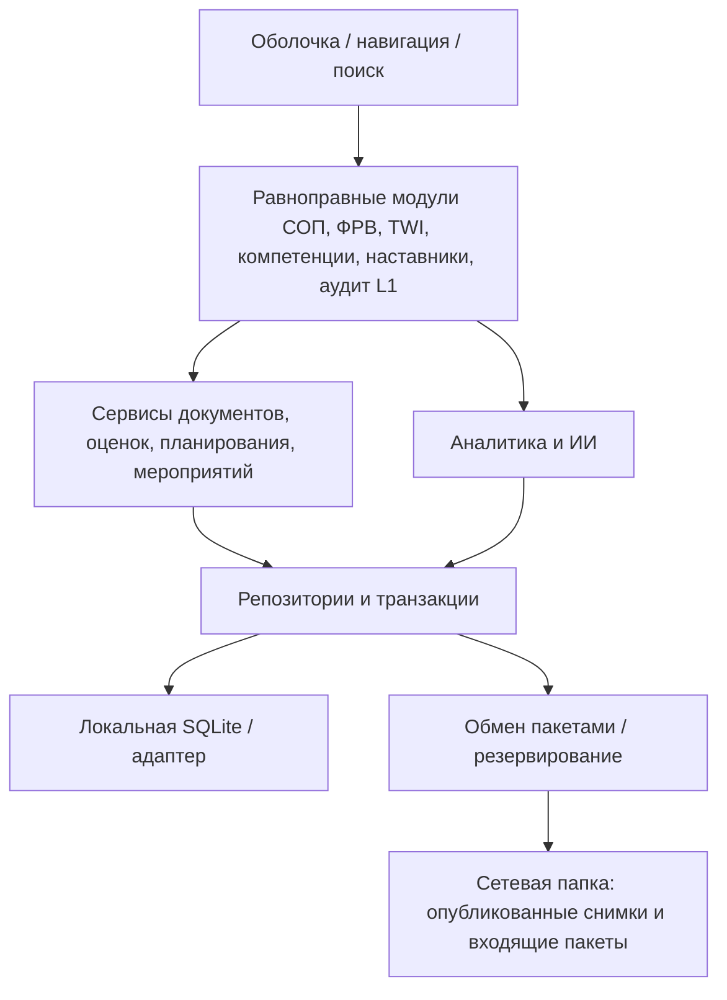

## LC7.3B — четвёртый проход: подтверждённое отсутствие циклов, измерение покрытия, календарь CAPA (26.11.2026)

Третий кандидат 853a1ca полностью прошёл [Actions 45801112468](https://github.com/shonentez-afk/Lean-Center/actions/runs/45801112468) Windows/Linux (138 JS, 5 Python, 19/19 smoke на каждой платформе) и [атлас 45801112478](https://github.com/shonentez-afk/Lean-Center/actions/runs/45801112478) SUCCESS. [Windows ZIP](https://github.com/shonentez-afk/Lean-Center/actions/runs/45801112468/artifacts/15108295360), [HTML-атлас](https://github.com/shonentez-afk/Lean-Center/actions/runs/45801112478/artifacts/15108350172). Это проверенные промежуточные кандидаты LC7.3B, не финальная пользовательская приёмка. Статистика атласа: 188 AST файлов, 8651 функций/методов, 18553 прямых вызовов/конструкторов, 4550 регистраций callback, 17 ручных контрактов, 74 таблицы/views, 207 FK, 827 SQL-связей, 27493 неразрешённых мест, **0 SCC** (включая reexport). Полный исполняемый Stage43 разобран; один старый исторический фрагмент stage19-network-io.js не разобран. Числа включают тесты, инструменты, исходные фрагменты и полный runtime; не число уникальных продуктовых функций. Все семь разделов атласа проверены на 320/390/768 px.

Четвёртый проход:
- ARCH-01: подтверждён ноль циклов; генератор теперь блокирует CI при возвращении статического import/reexport цикла.
- ARCH-02: общий аналитический контракт прошёл третий CI; дополнительно подключены реальные тестовые сценарии черновика/оценки СОП, взвешенного чек-листа, ФРВ, незакрытых планов, отрицательной практики и чернового денежного факта. Сборщик LC_ANALYTICS_COVERAGE_DIR пишет только числовые результаты синтетических проверенных срезов, имена тестовых файлов и строки, без исходных данных или идентификаторов людей. tools/lc73b/analytics-coverage.mjs создаёт coverage.json / coverage.csv, фиксирует нулевые и ненулевые состояния 30 метрик и 24 правил (23 активных одновременно), знаменатели, недостающие положительные кейсы. Отдельный артефакт LC7.3B-Analytics-Coverage-Windows/Linux; полный ненулевой охват не утверждать до CI.
- ARCH-03: уточнены типы дат: TWI held_at — вводимое гражданское локальное время без Z, observed_at и assessed_at — дата факта; recorded_at/occurred_at — timestamp UTC; weightedHistory — дата UTC-события, не вводимый день оценки. Не преобразовывать все поля одинаково. Часовой пояс предприятия ещё не согласован.
- ARCH-08: в повторном аудите/практике/СОП был UTC-порог вместо сохранённой деловой даты выполнения. Вынесен action-calendar.js, новое событие проверки получает verification_date_basis=implementation-civil-v1, для новых проверок исключён тот же день выполнения, для weighted evidence timestamp переводится в сохранённое смещение выполнения (сам исторический отчёт weightedHistory не меняется). История проверки показывает правило. Старые команды без маркера воспроизводятся по прежнему UTC-предикату, ранее зарегистрированные решения не переоцениваются молча; отдельные тесты границы UTC+7, последующей оценки, повторного нарушения и восстановления обеих версий. Это предлагаемое методическое уточнение, сохраняющее прежнее требование «после дня выполнения», а не общий переход предприятия на UTC+7. Важно: прежние клиенты могут отвергнуть новое поле в пакете — все участники пилота должны использовать одну принятую сборку, без смешивания LC7.3A и LC7.3B. Схема SQLite остаётся v17.
- Новый полный CI ещё не подтверждён. Реальная сеть, ACL, печать и облачные модели — LC7.4; LC7.3B не закрыт. Продолжить по фактической матрице покрытия, важным динамическим цепочкам и оставшимся датам, не выдавая статические связи за runtime.

## LC7.3B — третий проход: остаточные циклы, аналитические контракты и карта обмена (26.11.2026)

Второй кандидат 0936066: [атлас 45799845571](https://github.com/shonentez-afk/Lean-Center/actions/runs/45799845571) — unit PASS, генерация PASS, browser дошёл до проверки ширины 390 px и упал на overflow. Сгенерирован диагностический [артефакт 15105874609](https://github.com/shonentez-afk/Lean-Center/actions/runs/45799845571/artifacts/15105874609), не принятый выпуск. Фактическая статистика второго кандидата: 185 разобранных файлов (исходники, инструменты, тесты и закреплённый runtime Stage43), 8620 функций/методов, 18474 статических вызовов/конструкторов, 4528 регистраций callback, 10 контрактов, 74 таблицы/views, 207 FK, 827 SQL-ребер, 27417 неразрешённых мест. Исторический stage19-network-io.js по-прежнему содержит синтаксическую ошибку исходного фрагмента; полный исполняемый Stage43 разобран. Эти числа включают и исходные модули, и исполняемый runtime, поэтому не являются числом уникальных функций всего продукта. Две SCC по три файла вместо предыдущей SCC из 19. Продуктовый CI 45799845199: Windows PASS; Linux в работе на момент подготовки документа.

Третий проход:
- ARCH-01: из library/domain.js вынесены неизменённые проверка JSON/ссылок Stage43 и общие валидаторы в source-validation.js, frv-summary больше не импортирует обработчик команд. Из training/domain.js, preparation-results и standard-workflows вынесены общие факты и прогресс в training-facts.js. Сохранены прежние публичные экспорты, схема, содержимое функций и формулы. SCC теперь учитывает также reexport. Тест публичной идентичности и фактических данных; конечное отсутствие циклов ещё должен подтвердить новый атлас.
- ARCH-02: tests/lc73b-analytics-contract.mjs проверяет все 30 метрик и 23 активных контрольных сигнала (24 правила, два взаимоисключающих режима банка), числители/знаменатели, exact keys, декомпозицию и обратную фильтрацию, неподвижность текущих метрик при изменении исторического периода, равенство общего/участкового срезов с источниками, отсутствие записи в БД. Подключена проверка в шести действующих тестовых наборах: пустая база, обучение, допуск и пересмотр СОП, повторное нарушение L1, подготовка и утрата решения, банк вопросов, доплаты, денежные факты и их отмена/цели. Не утверждать, что все 30 метрик и 24 правила уже проверены в ненулевых состояниях: нужен успешный CI и отдельная матрица ненулевого покрытия.
- ARCH-07: переданный глобальный срез другой даты пересчитывается. Для устаревших банков показаны конкретные основания по всему центру, отсутствие банка остаётся сигналом, не фиктивной строкой.
- Карта: добавлено 7 ручных контрактов по 14 проверенным якорям (IndexedDB, контент до ссылки, пакет, приём, снимок, загрузка и backup); всего 17. Контракты обозначают допустимые переходы, не доказательство фактического выполнения или атомарности SMB.
- Атлас: локально ограничены длинные хэши, пути, grid и вложенные таблицы. Проверка всех семи представлений на 320/390/768 px с диагностикой виновников overflow.
- ARCH-03 остаётся открытым: единая деловая дата предприятия ещё не утверждена, локальные гражданские даты и UTC timestamp не смешивать автоматически. Реальные сетевые права, два ПК, корпоративная печать и YandexGPT — LC7.4.
- Новая полная регрессия и атлас требуются. LC7.3B не закрыт, принятая LC7.3A, main, SQLite v17, исходный Stage43 и production proxy неизменны.

## LC7.3B — второй проход: границы ядра, контракты исполнения и точность сигналов (26.11.2026)

Первый кандидат 86efff3: продуктовый Actions 45798382350 SUCCESS Windows/Linux. Архитектурный Actions 45798382411: unit PASS, генерация PASS (182/183 файлов, 6975 функций/методов, 14080 прямых вызовов/конструкторов, 74 таблицы/views, 207 FK, 827 SQL-связей, 22675 статически неразрешённых мест, 1 SCC из 19 файлов); browser FAIL на первом экране. Артефакт не опубликован. Это статистика первого кандидата, не актуального второго.

Второй проход:
- Исправлена вероятная причина пустого HTML: собственные исходники генератора содержат маркеры шаблона и попадали в JSON до второй подстановки. Однопроходный renderAtlas, проверка синтаксиса клиентского скрипта, тест с обоими маркерами и закрывающим script, диагностический вывод browser. CI сохраняет диагностику/сгенерированные файлы даже при ошибке; такой артефакт нельзя считать принятым до PASS.
- Активные фрагменты Stage43 анализируются как исходники; дополнительно извлекается целый исполняемый runtime из закреплённого HTML с проверкой Git blob и исходных строк. В первом отчёте stage19-network-io.js не разобран (await внутри не-async функции); исторический фрагмент не исправлялся и не подменялся, фактический runtime проверяется отдельно. Сторонний vendor не включён.
- ARCH-01: выделены низкоуровневые функции SQLite, UUID, сериализации, SHA-256 и нормализации в src/core/primitives.js без изменения тел; db.js сохраняет прежние публичные экспорты. 18 доменных файлов из обнаруженной SCC получают примитивы без обратной зависимости от центрального dispatch. Не утверждать устранение всех циклов до новой генерации; остаточные доменные циклы анализировать отдельно.
- AST: привязка callback, таймеров, event listeners, on* и методов с callback отделена от прямых вызовов; известные статические методы глобальных объектов учитываются только без лексического shadowing. 10 проверенных контрактов перехода по 20 фактическим якорям (Stage43 ready/load/loaded/source, ручное подтверждение и dispatch типов) добавлены отдельно от runtime-трассировки. Источники обоих концов сверены.
- ARCH-07: scopedAttention проверяет совпадение даты, подразделения, отсутствие персонального фильтра и наличие оснований перед повторным использованием проекции. Прежде чужой срез мог ошибочно показываться точным участковым. Сигналы L1 используют ключ конкретного ответа; добавлены регрессии несовместимой проекции и callback. ARCH-06 сохранён.
- Схема v17, основной branch, принятая LC7.3A, исходный Stage43 и production proxy не изменены. Требуется полный CI второго кандидата, проверка реестра оставшихся связей, ARCH-02/03, критических сценариев. LC7.3B не закрыт; LC7.4 ещё не начинается.

## LC7.3B — начало сквозного архитектурного аудита (26.11.2026)

Владелец явно принял LC7.3A: «все нет замечаний проходи к LC7.3B». Принятая продуктовая база [46b79c6](https://github.com/shonentez-afk/Lean-Center/commit/46b79c6ab23255a6b211afeadacd2be72f2ad803), [Actions 45795444858](https://github.com/shonentez-afk/Lean-Center/actions/runs/45795444858) SUCCESS, [Windows ZIP](https://github.com/shonentez-afk/Lean-Center/actions/runs/45795444858/artifacts/15104234499). Ветка `feature/lc7.3b-architecture-audit` создана от принятого SHA; `feature/lc7-ai-pilot`, `main`, схема v17 и исходный Stage43 не изменяются. Пользовательская приёмка интерфейса не подтверждает реальный SMB/ACL, корпоративскую печать или фактические маршруты YandexGPT: условия пилота LC7.4 остаются.

Добавлен воспроизводимый статический атлас исходного кода, функций, SQL, физической схемы, сквозных сценариев, циклов импортов и неразрешённых вызовов. Генератор `npm run audit:architecture` из checkout, отдельный CI и артефакт, см. [docs/LC7.3B_ARCHITECTURE_AUDIT_RU.md](LC7.3B_ARCHITECTURE_AUDIT_RU.md). Привязки 63 исходных якорей первой версии проверены чтением 22 файлов. Связи функций разрешаются по AST и лексическим областям; непроверенные получатели и динамический SQL не выдаются за достоверные связи. Активные модули Stage43 проверяются отдельно, глобальные связи требуют сверки с собранным baseline. Первый атлас и браузерный smoke ещё не подтверждены CI.

ARCH-06: исправлено незаметное снятие выбранного разреза дерева метрик при изменении фильтра. Пустые значения подразделения учитываются отдельно; выбранный разрез не расширяется автоматически, состояние сохраняется в route. Добавлены тесты смешанной базы с двумя участками и человеком без подразделения. Новый кандидат продукта lc7.3b-standard-dev проходит полную регрессию Windows/Linux. Остальные наблюдения — не закрытые дефекты. LC7.3B не завершён: нужны результаты генерации и CI, разрешение значимых динамических цепочек, проверка всех сквозных сценариев, подтверждение найденных проблем и исправления с регрессией. Не переходить к пилоту без приёмки.

## LC7.1 — начало принятого этапа LC7 (26.11.2026)

Владелец явно принял LC6.7.6 и разрешил переход к LC7. Принятая продуктовая база 4b58a9e, [CI 45776221067](https://github.com/shonentez-afk/Lean-Center/actions/runs/45776221067) SUCCESS (116 JS / 5 Python / 16 browser). Документирование приёмки 63c4d99. Новая рабочая ветка `feature/lc7-ai-pilot`, кандидат LC7.1-standard-dev. Основная ветка и принятая LC6.7.6 не меняются, рабочая база пустая.

LC7.1: действующий пункт «ИИ-помощник» в ежедневной работе; единая проекция контрольных сигналов для дашборда и локальных рекомендаций, фильтр направлений, объяснение основания и переход к существующим реестрам. Опциональный облачный совет через существующий YandexGPT Lite proxy: только фиксированные коды и общие описания максимум восьми тем, точный предпросмотр запроса, явное разрешение для каждого обращения; никаких данных сотрудников, документов, дат, сумм, исходников, токенов или идентификаторов базы. Перечень тем тоже может быть служебным. При ошибке сети офлайн работает; ответ не создаёт фактов и не изменяет БД. ИИ в конструкторе Stage43 не меняется. Схема v17 сохранена.

Новые тесты: пустая база, реальные события и сравнение с текущими проекциями, неизменность базы, точный исходящий payload, недопустимые темы/ответы, ошибки транспорта, браузерный сценарий offline/mock с переходом к источнику и проверкой мобильной ширины. Нужен новый CI. Реальный облачный сервис и разрешение предприятия не проверены; тесты используют перехват, не отправляют рабочие данные. Последующие пакеты — LC7.2 контекстные рекомендации, LC7.3 сквозной аудит архитектуры и процессов, LC7.4 SMB/ACL и пилот, LC7.5 инструкция, LC7.6 итоговая приёмка. См. docs/LC7_RU.md.

# Архитектура Lean Center v0.1
Статус: проект, не работающий runtime. 25.11.2026.

## Решение ADR-001: offline-first без сервера
Целевой интерфейс — автономное файловое веб-приложение с постоянным index.html, сборка из ES-модулей. Пробный storage: sql.js (SQLite WASM в памяти, байты БД экспортируются), IndexedDB как локальный кэш/черновик, ZIP для переносимых пакетов. Не открывать SQLite напрямую на SMB. Выбор физического runtime подтверждается прототипом в Chrome/Edge file://; fallback ручной импорт/экспорт файла. Не считать IndexedDB единственной копией. Нет требования Node/Docker/Connector на рабочих ПК. SharePoint только при доказанном доступе; не обязательная зависимость.

## Слои

Структура: src/shell, src/core, src/storage, src/services, src/modules/{sop,frv,twi,skills,mentoring,audit}, src/analytics, src/adapters/{stage43,rc1}, src/vendor, tests, docs, db/migrations. Модули не пишут напрямую в чужие таблицы: команды сервисов + транзакции. Аналитика читает репозитории/SQL views. Общие справочники, календарь и мероприятия не дублировать. Папочная сборка для file://; библиотека ECharts локально, лицензии сохранять. Исходные baselines неизменяемы.

## Данные
UUID для бизнес-сущностей; timestamps UTC ISO 8601; календарные даты ISO YYYY-MM-DD, локальная зона предприятия настраивается. История переводов, версия документов, чек-листов и шкал фиксируются. Никакого каскадного удаления истории. Оценки навыков и аудит JI отдельны по смыслу и формулам. Ноль не равен отсутствию оценки. Неизменяемые финальные записи исправляются новой ревизией/событием аннулирования с причиной. Утверждение документа и его вступление в силу различны. Фотографии и XLSX адресуются SHA-256, хранятся в переносимом пакете, метаданные в БД. Публикация и восстановление обязаны проверять foreign_key_check, integrity_check, manifest и контрольные суммы.

## Обмен без сервера
Один уполномоченный издатель master-снимка, остальные редактируют локальные копии. Пакет содержит package_id UUID, database_id, schema_version, base_publication_id, actor/device_id, created_at, события с event_id, entity_id, entity_type, expected_revision, operation, payload, hash и вложения. При импорте: валидация размера/формата/версии и хэшей; staging; дубликаты по event_id; конфликт expected_revision отправляется на ручное разрешение, не last-write-wins; транзакция с rollback; проверка FK; журнал; публикация нового неизменяемого снимка и manifest только после проверки. Повторная отправка безопасна. Сбой записи оставляет прежнюю публикацию. Не гарантировать атомарную замену файла браузером на SMB: использовать новые имена и проверяемый manifest. Единственный издатель — организационное ограничение, права обеспечиваются сетевыми ACL. Локальная роль и имя автора не доказывают личность. Не передавать чувствительные данные через публичный GitHub или неутверждённый облачный ИИ.

## Контракты
DocumentService выпускает версию и создаёт предложение о пересмотре обучения; TrainingService фиксирует факт обучения; AssessmentService подтверждает практический навык; AuditService оценивает методику наставника и создаёт finding; ActionService назначает/закрывает действие и отдельно верифицирует эффект; ScheduleService строит сроки; AnalyticsService возвращает значение, числитель, знаменатель, период, выборку, версию методики и ссылки на записи. Никаких автоматических снижений квалификации по аудиту. ИИ только рекомендации, офлайн функции без ИИ работают полностью.

## Проверки этапа 1
Два корпоративных ПК: открытие file://, разрешения файлов, чтение/запись сетевой папки, параллельные пакеты, конфликт одной записи, дубликат, повреждённый пакет, отключение сети, отказ записи, восстановление и сравнение хэшей. Проверить объёмы 1/10/100 МБ, фото, память, миграции. До прохождения не заявлять готовность общего хранения. Никаких реальных данных в CI.

## ADR-002: подтверждённое пользователем направление LC1 (25.11.2026)
Пользователь подтвердил SQLite WASM без установки и указал на уже реализованное сетевое сохранение в конструкторе СОП. Взять за основу точные модули Stage43: stage19-network-io.js (выбор/запоминание папки, разрешения, запись, резервирование, SHA-256), stage19-network-sync.js (обход папки, синхронизация, диагностика), stage37-data-loss-safety.js (защита черновика). Пользовательский сценарий сохранить: выбрать сетевую папку, проверить доступ, сохранить/обновить, показать состояние. Переработать протокол: старый sync выбирает запись по updatedAt и обнаруживает конфликт только при равном времени; общий JSON индекс и журнал могут перезаписываться. В Lean Center применять бинарные снимки SQLite, индивидуальные неизменяемые пакеты изменений с UUID и expected_revision, проверку хэшей, единый издатель master, ручное разрешение конфликтов и fallback ручного переноса. Не копировать last-write-wins и общий read-modify-write журнала. Доступ из корпоративского file:// к реальной сетевой папке для нового формата ещё не проверен. Не считать одобрение архитектуры подтверждением работы runtime.

## ADR-003: папочная поставка LC1.1 (согласовано пользователем)
Целевой запуск: ярлык на постоянный сетевой index.html. ZIP содержит LeanCenter/index.html, versions/<release>/app, vendor, assets, licenses, manifest и инструкцию. Исходный код остаётся ES-модульным, выпускной main.js — классический IIFE, остальные локальные скрипты загружаются через script defer, CSS — link. SQLite WASM в отдельном JS с байтами в base64; fetch и import под file:// не требуются. База и пользовательские файлы не включаются в ZIP, рекомендуем отдельную папку LeanCenter_Data. Обновлять каталог новой версии перед заменой корневого index.html; не смешивать программные и рабочие данные. Стабильный путь ярлыка; старый цельный HTML сохранён только для контрольной истории. Разрешение доступа к сетевой папке по-прежнему выдаётся браузеру. См. [DEPLOY_NETWORK_RU.md](DEPLOY_NETWORK_RU.md).
